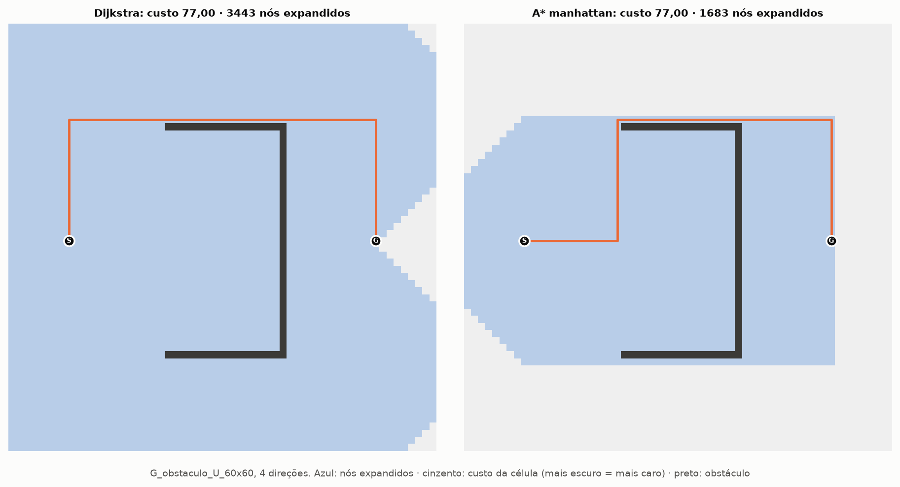
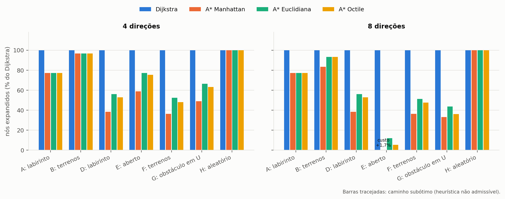
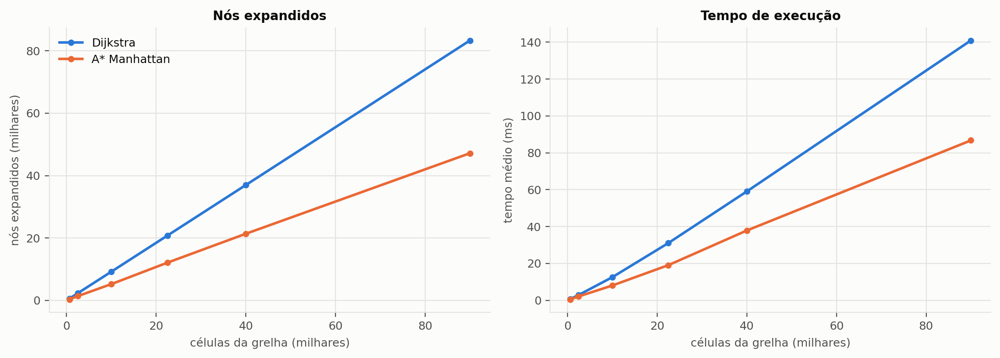
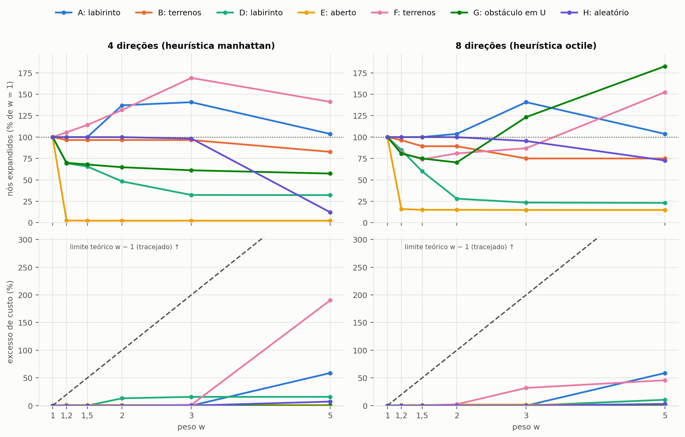

# Planeamento de Trajetos de um Robô Autónomo em Grelha 2D com Custos Variáveis

Projeto Prático 2, Inteligência Artificial (90498), Escola Superior de Gestão e Tecnologia de Águeda (ESTGA)
Cristiano Saraiva (125242), Nicolas Uchimura (122888)

> **Declaração de uso de IA generativa:** foi usada IA generativa como apoio à implementação do código, à estruturação do trabalho e à revisão do texto. As escolhas, a validação dos resultados e a sua justificação são da responsabilidade dos autores.

---

## 1. Problema e implementação

O mapa é uma grelha 2D em que o agente parte de uma célula S e procura chegar a G pelo caminho de menor custo total, passando apenas por células livres.
Cada célula livre tem um custo de entrada de 1 a 9, e o custo de um movimento é o custo da célula de destino.
Os obstáculos (`#`) são intransponíveis.
Consideram-se dois modelos de movimento, com 4 e com 8 direções.
Nas diagonais o custo é custo(destino) × √2.
Uma diagonal só é permitida se as duas células ortogonais adjacentes estiverem livres, ou seja, não se cortam esquinas.

O estado é a célula (linha, coluna), as ações são os movimentos permitidos e o custo é o definido acima.
Implementámos Dijkstra, A* e Weighted A* de raiz numa única função, `pesquisar()`, que difere apenas na prioridade usada na fronteira:

| Algoritmo | Prioridade f(n) |
|---|---|
| Dijkstra | g(n) |
| A* | g(n) + h(n) |
| Weighted A* | g(n) + w · h(n), com w ≥ 1 |

A fronteira é um `heapq`, com um dicionário de custos g e outro de predecessores para reconstruir o caminho.
Quando se encontra um g menor para um nó, insere-se uma nova entrada no heap em vez de atualizar a antiga.
As entradas obsoletas são descartadas quando saem da fronteira (eliminação preguiçosa).

O teste de objetivo é feito quando G é **retirado** da fronteira, e não quando é gerado.
Esta é a condição que garante a otimalidade de Dijkstra e do A* com heurística admissível.

Os empates em f são resolvidos por um contador de inserção (FIFO), para que os resultados sejam reprodutíveis.
Como variante, testámos também o desempate pelo menor h (secção 3.4).

Se a fronteira esvaziar sem chegar a G, o planeador indica que não existe caminho.
A pesquisa não entra em ciclo, graças ao conjunto de nós fechados.

Na comparação dos valores de g usa-se uma tolerância de 10⁻⁹.
Sem ela, somas com √2 feitas por ordens diferentes (por exemplo 1 + √2 + 1 e 1 + 1 + √2) diferem em cerca de 10⁻¹⁶.
O algoritmo tratava esse ruído numérico como um caminho melhor e reabria nós sem necessidade.
Detetámos o problema porque o A* com a heurística octile, que é consistente, reabria nós.

Cada pesquisa devolve:

- o caminho e o seu custo;
- o número de nós expandidos (incluindo reexpansões);
- o número de nós gerados e de reaberturas;
- a memória usada, medida pelo número de nós guardados em g;
- o tempo de execução.

**Heurísticas.** Nas fórmulas, dx e dy são as diferenças absolutas de coordenadas até G.
Cada heurística é multiplicada pelo custo mínimo de uma célula, que é 1 em todos os cenários.

| Heurística | Fórmula | 4 direções | 8 direções |
|---|---|---|---|
| Manhattan | dx + dy | admissível e consistente (exata sem obstáculos e com custo uniforme 1) | **não admissível**: uma diagonal avança 2 unidades de Manhattan com custo √2 < 2 |
| Euclidiana | √(dx² + dy²) | admissível e consistente, mas pouco informada | admissível e consistente |
| Octile | (dx + dy) + (√2 − 2) · min(dx, dy) | admissível e consistente, mas dominada pela Manhattan (octile ≤ Manhattan) | admissível e consistente; a mais informada das três |

A consistência resulta de h(n) ≤ c(n, n') + h(n') para todos os movimentos.
Esta condição verifica-se porque nenhum movimento custa menos do que a distância que a heurística assume percorrer com custo unitário.
Em 4 direções as três heurísticas são consistentes, e verifica-se Euclidiana ≤ Octile ≤ Manhattan, por isso a Manhattan é a mais informada.

Para o movimento diagonal, as aulas sugerem a Euclidiana ou a Chebyshev, max(dx, dy).
A Chebyshev é admissível em 8 direções, mas é a distância exata quando a diagonal custa 1, e aqui custa √2.
Como octile = max(dx, dy) + (√2 − 1) · min(dx, dy) ≥ max(dx, dy), a octile domina-a e, a menos de empates, nunca expande mais nós.
Por isso usámos a octile como heurística de referência em 8 direções.

## 2. Cenários e metodologia

Usámos nove cenários, todos guardados em ficheiros de texto na pasta `cenarios/`.
Três são os do Anexo A, para validação:

- A: labirinto 7×10;
- B: terrenos 5×9;
- C: sem caminho 4×6.

Os outros seis foram criados pelo grupo com `gerar_cenarios.py`, com semente base 42:

| Cenário | Dimensão | Descrição | Semente |
|---|---|---|---|
| D: labirinto | 61×61 | labirinto por *backtracking* recursivo, com 10% das paredes interiores removidas para criar ciclos | 42 |
| E: aberto | 120×120 | espaço aberto, custo 1, 5% de obstáculos dispersos (escalabilidade) | 142 |
| F: terrenos | 40×40 | custos de 1 a 9; o caminho com menos passos atravessa um pântano (custo 7–9) e o ótimo contorna-o por uma estrada de custo 1 | 242 |
| G: obstáculo em U | 60×60 | obstáculo côncavo virado para S, no caminho em linha reta até G | determinístico |
| H: aleatório | 80×80 | 28% de obstáculos e custos aleatórios de 1 a 9 em todas as células | 443 |
| I: sem caminho | 100×100 | G fechado num anel de obstáculos, num mapa com 10% de obstáculos | 542 |

Os cenários aleatórios usam `random.Random(42 + desvio)`.
Quando um mapa gerado não tem caminho, avança-se para a semente seguinte até obter um que tenha.
A semente efetivamente usada fica registada na tabela.
No cenário F, o caminho com menos passos não é o de menor custo:

| Movimento | Caminho com menos passos: passos / custo | Caminho ótimo: passos / custo |
|---|---|---|
| 4 direções | 39 / 206,00 | 71 / 71,00 |
| 8 direções | 37 / 194,97 | 67 / 68,66 |

Para cada combinação de cenário × algoritmo × heurística × modelo de movimento medimos:

- o custo do caminho;
- os nós expandidos;
- o tempo, como média de **N = 10** execuções, com o *garbage collector* desligado durante a medição.

O custo e os nós expandidos são determinísticos, e verificamos que são iguais nas 10 repetições.
Os tempos são indicativos: variam alguns por cento entre execuções, e o desvio-padrão fica registado em `resultados/comparacao.csv`.

A otimalidade verifica-se comparando o custo com o do Dijkstra.
A implementação é validada com os resultados do Anexo A: 17 / 17 no A, 20 / 18,83 no B e sem caminho no C, em 4 / 8 direções.
Além disso, os testes automáticos (`python -m unittest`) verificam em todos os cenários as seguintes propriedades:

- o A* com heurística admissível devolve o mesmo custo que o Dijkstra;
- o custo de cada caminho, recalculado movimento a movimento, coincide com o custo devolvido;
- o Weighted A* cumpre C* ≤ custo ≤ w · C*;
- uma heurística consistente nunca provoca reaberturas.

## 3. Resultados

### 3.1 Validação (Anexo A)

| Cenário | Custo 4 dir. (esperado → obtido) | Custo 8 dir. (esperado → obtido) | Nós 4 dir. Dijkstra / A* (esperado → obtido) |
|---|---|---|---|
| A (labirinto) | 17 → 17 ✔ | 17 → 17 ✔ | 35 / 27 → 35 / 27 ✔ |
| B (terrenos) | 20 → 20 ✔ | 18,83 → 18,83 ✔ | ≈ 31 / 29 → 30 / 29 |
| C (sem caminho) | sem caminho → sem caminho ✔ | sem caminho → sem caminho ✔ | 6 / 6 → 6 / 6 ✔ |

Todos os custos coincidem com os de referência, em 4 e em 8 direções, tanto com o Dijkstra como com o A*.
Esta comparação é verificada automaticamente pelo teste `TestAnexoA`.

A única diferença está nos nós expandidos pelo Dijkstra no cenário B: 30 em vez de 31.
A diferença vem apenas do desempate.
No código das aulas, a fronteira guarda pares `(g, (linha, coluna))`, pelo que os empates em g são resolvidos pela menor coordenada.
No nosso planeador, os empates são resolvidos pela ordem de inserção (FIFO).
Para o confirmar, corremos o código das aulas sobre os mesmos mapas:

| Mapa | Código das aulas (desempate por coordenadas) | Mesmo código com desempate FIFO | Nosso planeador |
|---|---|---|---|
| Grelha 8×8 da aula 9 | Dijkstra 37, A* 32 (custo 14) | Dijkstra 36 | Dijkstra 36, A* 32 (custo 14) |
| B (terrenos) | Dijkstra 31, A* 29 (custo 20) | Dijkstra 30 | Dijkstra 30, A* 29 (custo 20) |

Com o mesmo desempate, os resultados são idênticos.
O custo e a otimalidade nunca dependem do desempate; só o número de nós expandidos muda.

### 3.2 Dijkstra vs. A* (4 direções, Manhattan, desempate FIFO)

| Cenário | Dijkstra: custo / nós / tempo | A*: custo / nós / tempo | Ganho em nós | Ganho em tempo |
|---|---|---|---|---|
| D: labirinto 61×61 | 152 / 1805 / 5,8 ms | 152 / 692 / 2,5 ms | 61,7% | 56% |
| E: aberto 120×120 | 184 / 13 299 / 25,1 ms | 184 / 7835 / 16,5 ms | 41,1% | 34% |
| F: terrenos 40×40 | 71 / 837 / 1,4 ms | 71 / 304 / 0,6 ms | 63,7% | 54% |
| G: obstáculo em U 60×60 | 77 / 3443 / 5,7 ms | 77 / 1683 / 3,1 ms | 51,1% | 45% |
| H: aleatório 80×80 | 648 / 4535 / 7,0 ms | 648 / 4535 / 8,0 ms | 0% | −14% |
| I: sem caminho 100×100 | — / 8976 / 15,8 ms | — / 8976 / 18,2 ms | 0% | −15% |

Em todos os cenários com caminho, o A* obteve o mesmo custo que o Dijkstra, como era de esperar com uma heurística admissível.
O ganho em tempo é sempre um pouco menor do que o ganho em nós, porque cada expansão do A* tem o custo extra de calcular h.
Nos cenários H e I nenhum nó foi poupado, e o A* foi 14–15% mais lento do que o Dijkstra.

*Figura 1. Cenário G em 4 direções. O Dijkstra (esquerda) expande uma "onda" em todas as direções. O A* (direita) concentra-se entre S e G, mas tem de explorar o interior do U antes de o contornar. As figuras de todos os cenários estão em `figuras/caminhos/`.*

### 3.3 Heurísticas e modelos de movimento

| Cenário | Mov. | Dijkstra | Manhattan | Euclidiana | Octile |
|---|---|---|---|---|---|
| D: labirinto | 4 | 1805 | **692** | 1010 | 956 |
| D: labirinto | 8 | 1805 | 692 | 1010 | **956** |
| E: aberto | 4 | 13 299 | **7835** | 10 261 | 10 027 |
| E: aberto | 8 | 13 209 | 110 ✘ (custo 136,55 vs. 134,21) | 1578 | **699** |
| F: terrenos | 4 | 837 | **304** | 438 | 402 |
| F: terrenos | 8 | 840 | 306 | 430 | **399** |
| G: obstáculo em U | 4 | 3443 | **1683** | 2289 | 2175 |
| G: obstáculo em U | 8 | 3419 | 1132 | 1491 | **1235** |
| H: aleatório | 4 | 4535 | 4535 | 4535 | 4535 |
| H: aleatório | 8 | 4530 | 4522 | 4527 | 4525 |
| I: sem caminho | 4 / 8 | 8976 | 8976 | 8976 | 8976 |

A **negrito** está a melhor heurística admissível em cada linha.
✘ indica um caminho subótimo.

*Figura 2. Nós expandidos em percentagem do Dijkstra.*

- **A Manhattan em 8 direções não é admissível e perde a otimalidade.** No cenário E devolveu um caminho de custo 136,55, quando o ótimo é 134,21 (+1,7%), e expandiu apenas 110 nós. Nos restantes cenários o custo coincidiu com o ótimo, mas nada o garante. O número baixo de nós é precisamente o sintoma de uma heurística que sobrestima o custo restante.
- **Em 8 direções, a octile expande sempre menos nós do que a Euclidiana**, até 56% menos (1578 → 699 nós no cenário E), mantendo a otimalidade. Em 4 direções, os nós expandidos seguem a ordem Manhattan < Octile < Euclidiana. É o que prevê a dominância Euclidiana ≤ Octile ≤ Manhattan: quanto maior a heurística admissível, menos nós expande.
- **No labirinto, 8 direções dão exatamente o mesmo resultado que 4.** Os corredores têm uma célula de largura e os cantos entre paredes são sempre obstáculos, por isso nunca há duas células ortogonais livres que permitam uma diagonal sem cortar esquinas.

### 3.4 Efeito do desempate

Num mapa de custo uniforme com a Manhattan em 4 direções, todas as células do retângulo entre S e G têm o mesmo f = C*.
Com desempate FIFO, o A* expande uma grande parte delas.
Preferir, entre os nós com o mesmo f, o de menor h (o mais próximo de G) não altera o custo, mas muda drasticamente o esforço:

| Cenário (4 dir.) | FIFO | Menor h | Redução |
|---|---|---|---|
| E: aberto 120×120 | 7835 | 333 | 95,7% |
| G: obstáculo em U | 1683 | 1198 | 28,8% |
| D: labirinto | 692 | 596 | 13,9% |
| F, H, I | — | — | ≤ 0,3% |

Com 8 direções, ou com custos variáveis, há poucos empates e o efeito é marginal (≤ 3,6%).

### 3.5 Escalabilidade

*Figura 3. Mapa aberto n × n (5% de obstáculos, 4 direções), com n entre 25 e 300.*

No mapa de 300 × 300 (90 000 células), os três planeadores expandiram:

| Planeador | Nós expandidos | Tempo |
|---|---|---|
| Dijkstra | 83 343 | ≈ 198 ms |
| A* com desempate FIFO | 47 188 | ≈ 112 ms |
| A* com desempate pelo menor h | 1279 | ≈ 4 ms |

O tempo cresce linearmente com o número de nós expandidos, e o número de nós guardados em g (a memória) acompanha-o.

## 4. Extensão: Weighted A*

A função de avaliação passa a ser f(n) = g(n) + w · h(n), em que w = 1 corresponde ao A* normal.
Usámos a Manhattan em 4 direções e a octile em 8 direções, que são as heurísticas admissíveis e consistentes mais informadas em cada modelo.

Com w > 1, a heurística ponderada w · h deixa de ser admissível e consistente.
Mesmo assim, o custo devolvido é no máximo w vezes o ótimo, ou seja, o excesso de custo fica limitado a w − 1.
Este limite verifica-se tanto com reabertura de nós fechados como sem ela, desde que h seja consistente.
Por omissão permitimos a reabertura sempre que se encontra um g menor, e medimos também a variante sem reabertura.

Variámos w ∈ {1; 1,2; 1,5; 2; 3; 5} em todos os cenários com caminho e medimos três grandezas:

- os nós expandidos;
- o tempo;
- o excesso de custo, definido como custo / custo ótimo − 1.

*Figura 4. Em cima, nós expandidos em percentagem de w = 1. Em baixo, excesso de custo observado; a linha tracejada é o limite teórico w − 1 (com reabertura).*

**Valor de w a partir do qual o caminho deixa de ser ótimo, e redução de nós nesse ponto:**

| Cenário | 4 direções | 8 direções |
|---|---|---|
| D: labirinto | w = 2: +13,2% de custo, −52% de nós | w = 5: +10,5%, −77% |
| E: aberto | w = 1,2: +1,1%, −97% | w = 1,2: +0,9%, −84% |
| F: terrenos | w = 3: +1,4%, nós **+69%** | w = 2: +2,4%, −19% |
| G: obstáculo em U | ótimo para todos os w (até −43% de nós) | w = 5: +1,9%, nós **+83%** |
| H: aleatório | w = 5: +7,3%, −88% | w = 5: +3,0%, −27% |

O excesso observado ficou sempre muito abaixo do limite teórico.
Fora do cenário F, nunca passou de 16%, mesmo com w = 5, cujo limite é 400%.
No cenário F chegou a 32% e a 46% em 8 direções (w = 3 e w = 5) e a 190% em 4 direções com w = 5.
Nesse último caso a pesquisa, quase gulosa, atravessa o pântano em linha reta em vez de seguir a estrada.

O Weighted A* compensa claramente em espaços abertos.
No cenário E, com w = 1,2, expande 97% menos nós e o caminho fica apenas 1,1% mais caro.

**O Weighted A* nem sempre reduz o esforço.** No cenário F em 4 direções, os nós expandidos *aumentam* com w, até +69% com w = 3.
Ao dar mais peso a h, a pesquisa avança primeiro pelo pântano caro, na direção de G, e só depois descobre que tem de recuar para a estrada.
Com custos muito variáveis, a distância geométrica é um mau indicador do custo restante, e insistir nela sai caro.

**Reabertura de nós.** Reabrir nós aproxima o custo do ótimo, mas pode custar muitos nós.
No cenário G em 8 direções com w = 5, os dois modos dão:

| Modo | Excesso de custo | Nós face a w = 1 |
|---|---|---|
| Com reabertura | +1,9% | +83% |
| Sem reabertura | +11,3% | −38% |

Se o objetivo do Weighted A* é a rapidez, faz sentido não reabrir, já que o limite w · C* se mantém (tabelas completas em `resultados/tabelas.md`).

## 5. Discussão, limitações e conclusão

**Quando compensa o A*.** O A* compensa quando a heurística é uma boa estimativa do custo restante.
Isso acontece quando os custos das células estão perto do custo mínimo assumido pela heurística e o caminho pode avançar na direção do objetivo.

Nos cenários D, E, F e G expandiu 41–64% menos nós do que o Dijkstra, com o mesmo custo.
No cenário E, com desempate pelo menor h, expandiu 97,5% menos.
Ao contrário do que prevíamos, o A* compensou também no labirinto (−62%).
Como S e G estão em cantos opostos e o labirinto tem ciclos, a heurística continua a podar os ramos que se afastam de G.

O A* não trouxe qualquer ganho em dois casos:

- **Custos muito superiores ao mínimo (cenário H).** O custo médio de uma célula é cerca de 5, mas a heurística assume 1 por célula. Por isso h fica muito abaixo do custo real e o A* comporta-se como o Dijkstra, mas é 14% mais lento por calcular h.
- **Sem caminho (cenário I).** Para provar que não há solução é preciso explorar toda a região alcançável a partir de S, qualquer que seja a heurística.

O Dijkstra é preferível quando não há uma heurística admissível útil, ou quando se querem os custos até muitos destinos de uma só vez.

**Limitações.** A memória cresce com a área explorada, ou seja, com a fronteira e com os dicionários g e de predecessores.
Em grelhas grandes, o tempo é dominado pelo número de nós expandidos.

O A* é sensível à heurística.
Uma heurística inadmissível, como a Manhattan em 8 direções, pode perder a otimalidade.
Uma heurística pouco informada, como acontece com custos altos (cenário H), faz o A* ganhar pouco ou nada.
O custo adicional por nó do cálculo de h pode anular o ganho quando poucos nós são poupados.

O número de nós expandidos depende também do desempate, sobretudo em zonas de custo uniforme.
Os tempos medidos em Python são indicativos e variam alguns por cento entre execuções.
Por fim, o trabalho trata apenas o planeamento num mapa estático: o replaneamento perante alterações no mapa não foi abordado.

**Conclusão.** Com uma heurística admissível e consistente, o A* devolveu sempre o caminho ótimo e expandiu até 64% menos nós do que o Dijkstra (97,5% com o desempate pelo menor h).
Em 8 direções a octile foi a melhor heurística, e a Manhattan perdeu a otimalidade, como a teoria previa.
O Weighted A* trocou otimalidade por velocidade de forma muito favorável em espaços abertos, mas foi contraproducente em terrenos de custo muito variável.
O excesso de custo ficou sempre muito abaixo do limite teórico w − 1.

---

*Reprodução:* `python gerar_cenarios.py && python -m unittest && python experiencias.py`.
As tabelas completas estão em `resultados/tabelas.md` e os dados brutos em `resultados/*.csv`.
