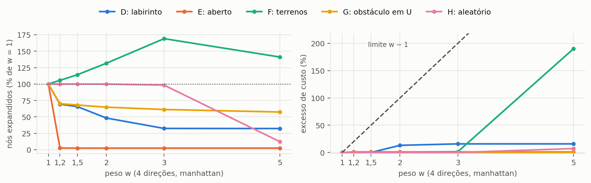

# Trabalho 2: Planeamento de Trajetos

Inteligência Artificial (UC 90498), ESTGA. Cristiano Saraiva (125242), Nicolas Uchimura (122888).

## 1. Problema e implementação

O estado é a célula (linha, coluna), e as ações são os movimentos em 4 ou 8 direções.
Cada movimento custa o custo da célula de destino, multiplicado por √2 nas diagonais.
Não se cortam esquinas.
O Dijkstra e o A* partilham uma função, que só muda a prioridade na fronteira: g para o Dijkstra, g + h para o A* e g + w·h na extensão.

A fronteira é um `heapq`, e há dicionários de custos g e de predecessores.
O objetivo é testado quando o nó sai da fronteira, o que garante a otimalidade.
Um conjunto de nós fechados impede ciclos e permite indicar que não há caminho.
Os empates em f resolvem-se por ordem de inserção.

Como o custo mínimo de uma célula é 1, nenhum movimento custa menos do que a distância que h assume.

| Heurística | 4 direções | 8 direções |
|---|---|---|
| Manhattan, dx + dy | admissível e consistente | **não admissível**: conta 2 por diagonal, que custa √2 |
| Euclidiana, √(dx² + dy²) | admissível e consistente | admissível e consistente |
| Octile, max + (√2 − 1)·min | admissível e consistente | admissível e consistente; a mais informada (≥ Euclidiana e ≥ Chebyshev, max(dx, dy)) |

## 2. Cenários e metodologia

Usámos nove cenários, todos guardados em `cenarios/`: os três do Anexo A e seis gerados pelo grupo com semente fixa 42.
Os seis do grupo são: D, labirinto 61×61 com ciclos; E, espaço aberto 120×120 com 5% de obstáculos; F, terrenos 40×40 em que o caminho com menos passos custa 206 e o ótimo 71; G, obstáculo côncavo em U 60×60; H, mapa aleatório 80×80 com custos 1–9 e 28% de obstáculos; I, mapa 100×100 sem caminho.

Medimos o custo, os nós expandidos e o tempo (média de 10 execuções) para cada cenário, algoritmo, heurística e modelo de movimento.
A otimalidade é verificada contra o Dijkstra.

**Validação.** Os custos do Anexo A coincidem: A 17/17, B 20/18,83 e C sem caminho.
Os nós expandidos pelo Dijkstra e pelo A* foram A 35/27, B 30/29 e C 6/6.
No B, o valor de referência (cerca de 31) só difere por causa do desempate (ver o notebook).

## 3. Resultados

Nós expandidos pelo Dijkstra e pelo A* nos cenários do grupo (redução entre parênteses):

| Cenário | 4 dir.: custo · Dijkstra → A* Manhattan | 8 dir.: custo · Dijkstra → A* Octile | 8 dir.: A* Euclidiana / Manhattan |
|---|---|---|---|
| D: labirinto | 152 · 1805 → 692 (−62%) | 152 · 1805 → 956 (−47%) | 1010 / 692 |
| E: aberto | 184 · 13 299 → 7835 (−41%) | 134,21 · 13 209 → 699 (−95%) | 1578 / 110 **✘ custo 136,55** |
| F: terrenos | 71 · 837 → 304 (−64%) | 68,66 · 840 → 399 (−52%) | 430 / 306 |
| G: obstáculo em U | 77 · 3443 → 1683 (−51%) | 62,36 · 3419 → 1235 (−64%) | 1491 / 1132 |
| H: aleatório | 648 · 4535 → 4535 (0%) | 559,94 · 4530 → 4525 (0%) | 4527 / 4522 |
| C e I: sem caminho | 6 → 6 e 8976 → 8976 | igual | igual |

Com heurísticas admissíveis, o A* obteve sempre o custo ótimo, e o tempo acompanha os nós expandidos.
Nos cenários H e I não há nós poupados, e o A* fica 10–30% mais lento do que o Dijkstra por causa do cálculo de h.

Em 8 direções, a octile nunca expandiu mais nós do que a Euclidiana (até −56%).
A Manhattan, que não é admissível em 8 direções, perdeu a otimalidade no cenário E (+1,7% de custo).

Em espaço aberto de 300×300, o A* expandiu menos 43% de nós do que o Dijkstra (47 188 contra 83 343).
O tempo de ambos cresce linearmente com a área explorada.

## 4. Extensão: Weighted A*

Usámos f = g + w·h, com w ∈ {1; 1,2; 1,5; 2; 3; 5}, a Manhattan em 4 direções e a octile em 8.
Com w > 1, w·h deixa de ser admissível, e por isso reabrimos nós fechados quando se encontra um g menor.
O custo fica limitado a w·C*.

Primeiro w em que o caminho deixa de ser ótimo (excesso de custo / variação de nós face a w = 1):

| Cenário | 4 direções (Manhattan) | 8 direções (Octile) |
|---|---|---|
| E: aberto | w = 1,2 (+1,1% / −97%) | w = 1,2 (+0,9% / −84%) |
| D: labirinto | w = 2 (+13,2% / −52%) | w = 5 (+10,5% / −77%) |
| F: terrenos | w = 3 (+1,4% / **+69%**) | w = 2 (+2,4% / −19%) |
| G: obstáculo em U | sempre ótimo (até −43%) | w = 5 (+1,9% / **+83%**) |
| H: aleatório | w = 5 (+7,3% / −88%) | w = 5 (+3,0% / −27%) |

O excesso de custo ficou sempre abaixo do limite w − 1.
O pior caso foi o cenário F com w = 5: 190%, contra um limite de 400%.

## 5. Discussão, limitações e conclusão

O A* compensa quando h se aproxima do custo real, ou seja, quando os custos estão perto do mínimo e o mapa deixa avançar em direção a G.
Nesses cenários poupou 41–95% dos nós.

**Cenários desfavoráveis ao A*.** Com custos muito acima do mínimo (H, custo médio ≈ 5 contra 1 em h), h subestima muito o custo restante e o A* faz o mesmo que o Dijkstra, mais devagar.
Sem caminho (C e I), é preciso explorar toda a região de S, qualquer que seja a heurística.
O Dijkstra é preferível nesses casos, ou quando se querem os custos até muitos destinos.

**Limitações.** A memória (fronteira e dicionários) e o tempo crescem com a área explorada, e uma heurística inadmissível (Manhattan em 8 direções, ou w > 1) perde a otimalidade.

**O que não esperávamos.** O A* compensou também no labirinto (−62%), porque poda os ramos que se afastam de G.
Nos terrenos, aumentar w **aumentou** o esforço (+69%): a pesquisa entra no pântano caro em direção a G e só depois recua para a estrada.

O Weighted A* é muito vantajoso em espaços abertos, mas é contraproducente em terrenos de custo muito variável.

*Declaração de uso de IA generativa:* foi usada como apoio na implementação do código, na estruturação do trabalho e na revisão do texto. As escolhas e a sua justificação são da responsabilidade dos autores. O código, o notebook executado (`experiencias.ipynb`) e as instruções de reprodução estão no repositório (`README.md`).
